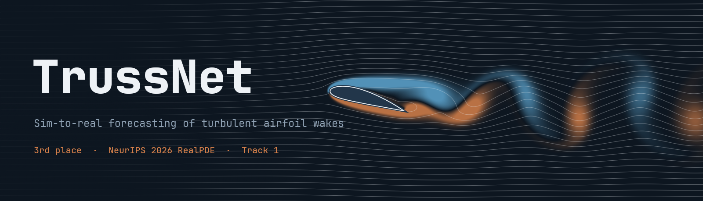
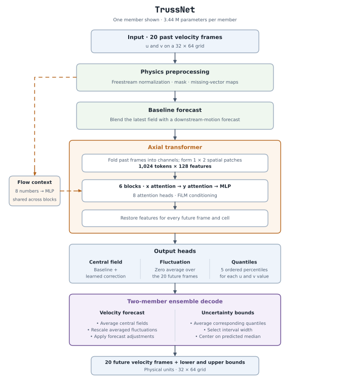
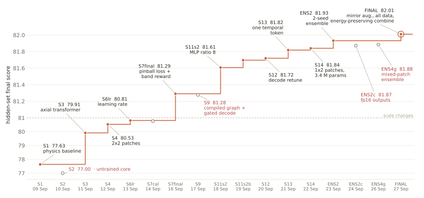

<p align="center">
  
</p>

<p align="center">
  <a href="https://real-pde-competition.github.io/"></a>
  <a href="https://huggingface.co/datasets/AI4Science-WestlakeU/RealPDE-Competition-Data"></a>
  
  <a href="LICENSE"></a>
</p>

<p align="center">
  <b>A physics-first transformer that learns from simulation and noisy measurements to forecast real turbulent flow.</b>
</p>

Learned flow surrogates are fast, but they often break down on real, noisy measurements. TrussNet starts from physics instead. A frozen-turbulence forecast makes the first guess, and a compact axial transformer corrects it. From 20 particle image velocimetry (PIV) frames of the wake behind an airfoil, it forecasts the next 20 frames of the velocity field with calibrated uncertainty bounds, running in about 1 ms. Built by Team PhysicsOracle, it placed **#3 out of 500 teams** in Track 1 (Sim-to-Real) of the [NeurIPS 2026 RealPDE Competition](https://real-pde-competition.github.io/).

<table align="center">
  <tr>
    <td align="center"><b>#3 out of 500</b><br><sub>teams in Track 1</sub></td>
    <td align="center"><b>3.44 M</b><br><sub>parameters per ensemble member</sub></td>
    <td align="center"><b>1.1 ms</b><br><sub>per forecast window on an A100</sub></td>
    <td align="center"><b>≈ 3 h</b><br><sub>full training on one RTX 4090</sub></td>
  </tr>
</table>

## The challenge

High-fidelity flow simulations are accurate but expensive, which has made fast learned surrogates an active area of research. However, these surrogates are not yet reliable enough for the real world. In real experiments, measurements are noisy, velocity vectors go missing, and the airfoil and its shadow occlude parts of the laser sheet. Learning from simulation and measurement data together is a key step toward surrogates that hold up outside the simulator.

The training set holds **81 real PIV trajectories** and **100 simulated trajectories** across Reynolds numbers and angles of attack, so most of the data is simulated. Submissions are scored on hidden real measurements by forecast error, turbulent kinetic energy, mean velocity profiles, the quality of the uncertainty band and inference speed.

## How TrussNet works

TrussNet does not learn the flow from scratch. A simple physics-based forecast makes the first guess, and the network only learns what that guess gets wrong.

<p align="center">
  <picture>
    <source media="(prefers-color-scheme: dark)" srcset="docs/figures/architecture_dark.svg">
    
  </picture>
</p>

1. **Physics first guess.** We estimate the freestream velocity from the top rows of the measurement, normalize the flow by it and read the airfoil geometry from the PIV mask. Following Taylor's frozen turbulence hypothesis, the baseline advects the latest fluctuations downstream and blends them with the most recent field. On its own, this baseline already scores 77.63.
2. **Axial transformer correction.** The 20 input frames are folded into channels and grouped into 1 × 2 patches, giving 1,024 tokens. Six blocks attend along the streamwise direction and then across it. FiLM conditioning injects eight flow descriptors, such as flow speed, time step, mask size and whether the input is real or simulated.
3. **Three output heads.** For every future frame and cell, the network predicts a correction to the baseline, a zero-mean fluctuation field that keeps the forecast turbulent instead of smooth, and five ordered quantiles of its own error.
4. **Calibrated uncertainty.** A pinball loss trains the quantiles, and a differentiable version of the competition's band score tunes their width. At inference, we pick the interval width that best trades coverage against sharpness.
5. **Energy-preserving ensemble.** Two members trained with different seeds are averaged. Averaging two turbulent forecasts cancels part of their fluctuations wherever they disagree in phase, which leaves the average smoother and weaker than real turbulence. TrussNet therefore rescales the averaged fluctuation $\bar f$ in every cell so that it carries the same turbulent energy as the individual members $f_k$, leaving the mean flow and the uncertainty band untouched.

   $$\tilde f = \bar f \sqrt{\frac{\tfrac{1}{2} \sum_k \mathrm{var}_t f_k}{\mathrm{var}_t \bar f}}$$

   Both members are compiled together ahead of time with AOTInductor, so no Python runs in the timed path.

### Closing the sim-to-real gap

- Real and simulated data are trained together. Each training window comes from a real measurement with probability 0.75 and from a simulation with probability 0.25, and every epoch draws a fresh set of windows.
- Simulated frames receive real measurement masks, random missing vectors and noise so they look like PIV data.
- Simulation is subsampled to match the convective time step of the real measurements.
- Each window is mirrored vertically with probability 0.5, with the cross-stream velocity negated.

The full description, including every hyperparameter, is in [docs/METHOD.md](docs/METHOD.md).

## Results

We submitted 17 times to the development leaderboard, each scored on hidden real measurements. The large gains came early, later changes added less and less, and the score levels off near 82. The approach we chose appears to be converging.

<p align="center">
  <picture>
    <source media="(prefers-color-scheme: dark)" srcset="docs/figures/progress_dark.svg">
    
  </picture>
</p>

## Getting started

TrussNet needs Python 3.10 and an NVIDIA GPU. The pinned environment matches the competition's evaluation container.

```bash
git clone https://github.com/sametkocbay/TrussNet.git
cd TrussNet
uv sync && source .venv/bin/activate
```

The training data is published on Hugging Face as [AI4Science-WestlakeU/RealPDE-Competition-Data](https://huggingface.co/datasets/AI4Science-WestlakeU/RealPDE-Competition-Data), about 16 GB in total. Download and unpack it, then build the cache and train the two members.

```bash
mkdir -p data/raw && cd data/raw
curl -fL https://huggingface.co/datasets/AI4Science-WestlakeU/RealPDE-Competition-Data/resolve/main/train_real.tar.gz | tar xz
curl -fL https://huggingface.co/datasets/AI4Science-WestlakeU/RealPDE-Competition-Data/resolve/main/train_sim.tar.gz | tar xz
cd ../..

python rpde/tools/make_cache.py --raw data/raw
python -m rpde.train --config configs/final.yaml --fold full --seed 3 --name fm_all_s3
python -m rpde.train --config configs/final.yaml --fold full --seed 4 --name fm_all_s4
```

To reproduce the complete submission, with gate fitting, ahead-of-time compilation and packaging, use the Docker image.

```bash
python tools/make_final_package.py
docker build -t trussnet dist/final/package
docker run --rm --gpus all --shm-size 32g \
  -v "$PWD/data/raw":/data:ro -v /path/to/output:/output trussnet \
  python -c "import solution; solution.train('/data', '/output', 'cuda')"
```

Load the trained predictor and forecast.

```python
import numpy as np
import solution

predictor = solution.load_predictor("/path/to/output", "cuda")
x = np.zeros((5, 20, 32, 64, 3), dtype=np.float32)   # batch, frames, height, width, (u, v, p)
out = predictor.predict(x)                            # dict with "prediction", "lower", "upper"
```

The two trained members from our submission are included in [`weights/`](weights). The steps to rebuild and verify the exact competition package are in [docs/REPRODUCE.md](docs/REPRODUCE.md).

## Repository layout

```text
├── solution.py            train() and load_predictor(), the competition entry points
├── configs/final.yaml     training recipe and decode settings of the submission
├── rpde/                  model, training, losses, ensemble decode and compilation
│   ├── scaffold.py        physics first guess
│   └── cores/axial.py     axial transformer core
├── submission/            inference runtime that ran on Codabench
├── weights/               the two submitted ensemble members
├── logs/                  original training logs
├── docs/                  method, reproduction guide and figures
└── tools/                 packaging and figure scripts
```

## Who we are

We are three master's students at the Technical University of Munich with backgrounds in aerodynamics, numerical methods and machine learning. As Team PhysicsOracle, we build machine learning models for physics that hold up on real, noisy measurements. We are especially excited about what computer vision can teach physics, from attention over images to learning from imperfect sensor data, and about bringing ideas across the two fields in both directions.

<table>
  <tr>
    <td width="33%" valign="top">
      <p align="center"><br><b>Samet Kocbay</b></p>
      <ul>
        <li>M.Sc. Computational Science and Engineering, TUM</li>
        <li>FDE at Neural Concept</li>
        <li>Former Head of Aerodynamics, KA-RaceIng</li>
      </ul>
    </td>
    <td width="33%" valign="top">
      <p align="center"><br><b>Maximilian Leutschafft</b></p>
      <ul>
        <li>M.Sc. Computational Science and Engineering and M.Sc. Robotics, Cognition, Intelligence, TUM</li>
        <li>Built the first Hyperloop demonstrator for passenger transport</li>
      </ul>
    </td>
    <td width="33%" valign="top">
      <p align="center"><br><b>Oscar Breiner</b></p>
      <ul>
        <li>M.Sc. Computer Science, TUM</li>
        <li>2025 A2RL world champion in autonomous racing</li>
        <li>Former machine learning lead at WARR, two satellites launched</li>
      </ul>
    </td>
  </tr>
  <tr>
    <td align="center"><a href="https://github.com/sametkocbay">GitHub</a></td>
    <td align="center"><a href="https://github.com/maxileutschafft">GitHub</a></td>
    <td align="center"><a href="https://github.com/oscarbreiner">GitHub</a></td>
  </tr>
</table>

Reach the team at physicsoracle.awesome@gmail.com.

## Citation

If you use TrussNet in your work, please cite it. The competition results paper will be linked here once it is published.

```bibtex
@software{kocbay2026trussnet,
  title  = {{TrussNet} for Physics-First Sim-to-Real Forecasting of Turbulent Airfoil Wakes},
  author = {Kocbay, Samet and Leutschafft, Maximilian and Breiner, Oscar},
  year   = {2026},
  note   = {Third place, NeurIPS 2026 RealPDE Competition, Track 1 (Sim-to-Real)},
  url    = {https://github.com/sametkocbay/TrussNet}
}
```

## Acknowledgements

We thank Prof. Ronald Clark of the Perceptual Intelligence and Extended Reality Lab (PIXL), Department of Computer Science, University of Oxford, for advising us during the project.

We thank the organizers of the NeurIPS 2026 RealPDE Competition for the dataset, the evaluation platform and their support throughout the competition. The scoring code in [`third_party/realpde_kit/`](third_party/realpde_kit) is theirs and is included unmodified.

## License

TrussNet is released under the [MIT License](LICENSE). The organizers' scoring code in `third_party/` is not covered by this license.
